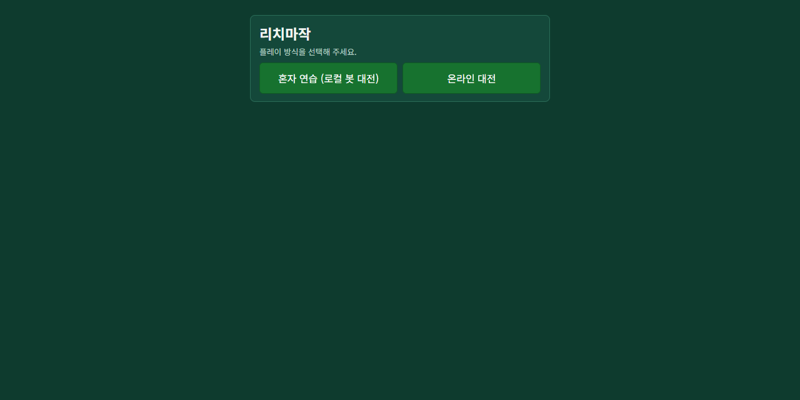
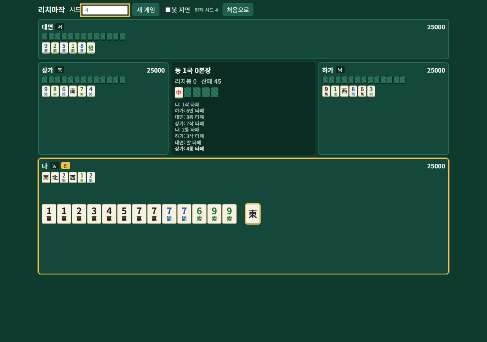
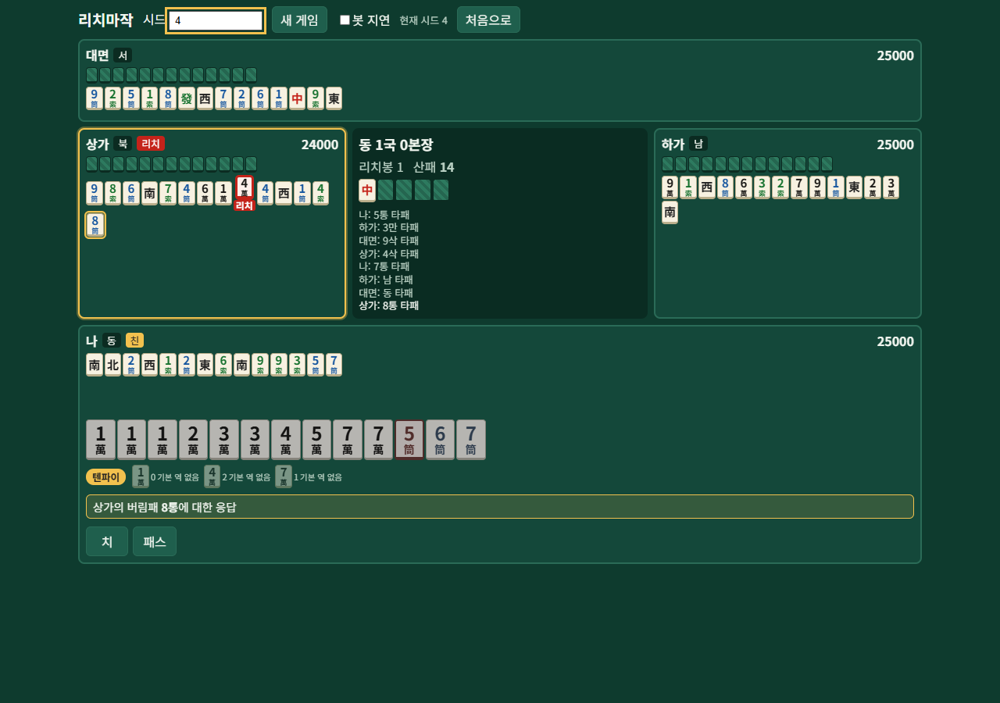
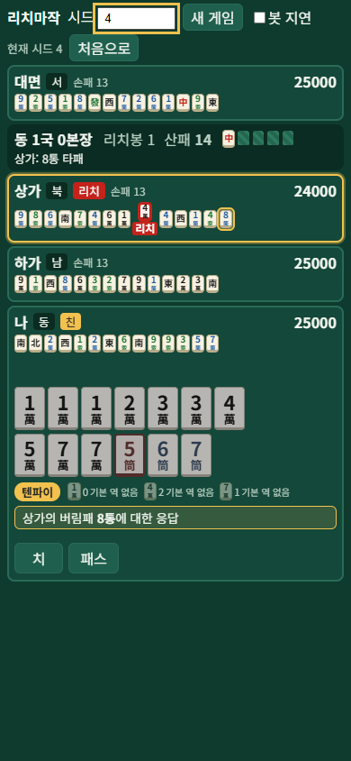
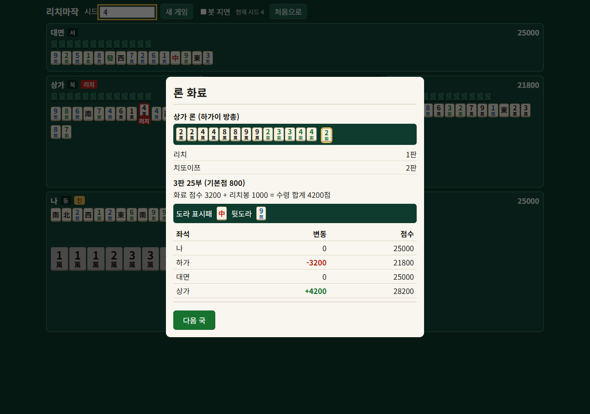

# webgame

**플레이: <https://park-jong.github.io/webgame/>** (GitHub Pages는 정적 호스팅이라 혼자 연습하는 로컬 모드만 동작한다)

일본식 리치마작(4인, 동풍전)을 브라우저에서 즐기는 웹 게임이다. 룰 엔진은 네트워크·UI에 의존하지 않는 순수 TypeScript로 작성했고, 브라우저만으로 사람 1명 + 봇 3명이 진행하는 로컬 모드, 서버가 모든 판정을 맡는 온라인 대전(방 ID 입장), 호스트 브라우저가 서버 역할을 하는 P2P 멀티플레이가 동작한다. 아직 개발 중이다.

저장소는 npm workspaces 모노레포이며 룰 엔진(`packages/core`), WebSocket 서버(`packages/server`), React + Vite 웹 클라이언트(`packages/web`)로 나뉜다.

## 스크린샷

로컬 모드(시드 4)에서 캡처했다. 같은 시드와 같은 조작이면 같은 장면이 재현된다.

| 화면 | 이미지 |
|---|---|
| 모드 선택(혼자 연습 / 온라인 대전) |  |
| 로컬 대국 중(데스크톱 1280px) |  |
| 텐파이 배지와 대기패 |  |
| 모바일 폭(390px) |  |
| 결과 모달(론 화료) |  |

이미지는 `node scripts/capture-screenshots.mjs`로 다시 만들 수 있다. 웹 dev 서버를 빈 포트로 띄우고 `puppeteer-core`와 시스템 Edge/Chrome(`E2E_BROWSER`로 경로 지정 가능)으로 `docs/screenshots/`에 저장한 뒤 서버를 종료한다.

## 현재 상태

| 단계 | 내용 | 상태 |
|---|---|---|
| 1 | 룰 엔진 (`packages/core`) | 완료 |
| 2 | 로컬 웹 플레이 (`packages/web`) | 완료 |
| 3 | 서버(`packages/server`)와 웹의 온라인 연결 | 완료 (영속화와 서버 배포는 미구현. 웹 정적 배포는 GitHub Pages 스크립트가 있으며 로컬 모드만 동작) |
| 4 | 매칭 (로비, 방 목록, 랭크 큐) | 미구현 |
| 5 | 부가 기능 (계정, 전적, 관전, 리플레이) | 미구현 |

단계별 상세와 진행 기록은 [`ROADMAP.md`](ROADMAP.md)를 본다. 마지막으로 확인한 테스트 수는 core 611 / server 204 / web 353개다.

## 구현된 룰

- 진행: 동풍전, 적도라, 도라/겉도라/뒷도라/깡도라, 렌짱·친 교대, 노텐 벌부, 리치봉·본장
- 역: 일반 역 28종, 역만 11종, 더블역만 4종 (표기와 명세는 [`docs/yaku-spec.md`](docs/yaku-spec.md))
- 상황 역: 리치, 일발, 더블리치, 창깡, 영상개화, 해저로월/하저로어, 천화/지화
- 판정: 후리텐(자기 버림패·동순·리치 후), 쿠이가에시(치/퐁 직후 현물·스지 금지), 더블론
- 유국: 유국만관(나가시만관), 도중유국(구종구패, 사풍연타, 사개깡, 사가리치), 삼가화는 기본 유국이며 옵션으로 3명 모두 화료 인정
- 버림패 표시: 뽑은 패를 그대로 버린 쯔모기리 패는 약간 어둡게(title "쯔모기리"), 손패에서 골라 버린 테다시 패는 그대로 표시
- 리치 후 안깡: 뽑은 패가 4장째이고, 뽑기 전 모든 화료 분해에서 그 3장이 각자이며 깡 전후 대기가 같을 때만 허용. 치/퐁/명깡/가깡은 불가
- 패오(책임지불): 대삼원·대사희. 쯔모는 책임자가 전액, 론은 역만 몫의 절반을 책임자가 부담. 소사희·사깡쯔는 대상이 아님
- 인화는 룰에 넣지 않기로 했다.
- 봇은 후로·깡·방어를 하지 않는다.

## 빠른 시작

Node.js 22에서 개발·검증했다. 저장소 루트에서:

```bash
npm install          # 의존성 설치 (워크스페이스 전체)
npm run dev:all      # 서버(기본 8080)와 웹(vite, 기본 http://localhost:5173)을 함께 실행. Ctrl+C로 둘 다 종료
```

`dev:all`(`scripts/dev-all.mjs`)은 서버와 vite를 각각 node 프로세스로 띄우고 출력에 `[server]`/`[web]` 접두어를 붙인다. 한쪽이 종료되면 나머지도 종료하며, 셸을 거치지 않아 cmd·PowerShell·bash에서 같게 동작한다. 터미널을 강제로 닫아 자식이 남으면 8080/5173을 쓰는 프로세스를 직접 종료한다.

### 명령

| 목적 | 명령 |
|---|---|
| 서버 + 웹 동시 실행 | `npm run dev:all` |
| 서버만 | `npm run dev -w @mahjong/server` |
| 웹만 | `npm run dev -w @mahjong/web` |
| 빌드(타입 검사 포함) | `npm run build` |
| 전체 테스트 | `npm test` (core + server + web) |
| 패키지별 테스트 | `npm test -w @mahjong/core` 등 |
| 브라우저 E2E | `npm run e2e -w @mahjong/web` (기본 `npm test`에 미포함) |
| GitHub Pages 배포 | `npm run deploy:pages` ([GitHub Pages 배포](#github-pages-배포) 참고) |
| README 스크린샷 재생성 | `node scripts/capture-screenshots.mjs` |

### 로컬 모드

웹을 열면 모드 선택 화면이 나온다. **혼자 연습(로컬)**은 서버 없이 브라우저만으로 사람 1명 + 봇 3명이 진행한다. 웹만 실행해도 된다.

### 온라인 모드

1. 모드 선택에서 **온라인 대전**을 고른다(`http://localhost:5173/?online=1`로 열면 바로 입장 화면). 이름(1~32자)과 서버 주소(기본 `ws://localhost:8080`)를 확인한다.
2. **방 만들기**를 누르면 대기실에 방 ID가 표시된다. 다른 사람은 방 ID를 입력하고 **입장**한다. 방당 사람은 최대 4명이다.
3. 대기실의 누구든 **시작**을 누르면 게임이 시작되고, **빈 좌석은 봇이 채운다**. 시작 후에는 새로 입장할 수 없다(재접속만 가능).
4. 국이 끝나면 결과 창이 뜨고 약 5초 뒤 다음 국이 자동 시작된다. 게임이 끝나면 순위가 나오고 "나가기"로 돌아간다. 온라인에는 새 게임 버튼이 없다(새 방을 만든다).
5. 내 차례는 30초, 응답(론/후로 선택)은 15초 안에 행동하지 않으면 서버가 자동 처리하고, 연속 3회면 자동 모드가 된다. 연결이 끊기면 자동 재접속하며, 새로고침해도 저장된 세션으로 이어진다.

같은 PC에서 두 번째 사람은 다른 브라우저 또는 시크릿 창을 쓴다(일반 창끼리는 저장된 세션(localStorage)을 공유한다). 원격 사람과 하려면 서버를 외부에서 접근 가능하게 하고 서버 주소를 바꿔야 한다. TLS·IP 제한 등 운영 보호는 아직 없다.

### 포트와 환경변수

| 변수 | 대상 | 기본값 | 설명 |
|---|---|---|---|
| `PORT` | 서버 | `8080` | 서버 리슨 포트. `dev:all`은 이 값을 서버에 넘기고 웹의 기본 서버 주소도 `ws://localhost:$PORT`로 맞춘다(빈 값은 8080) |
| `VITE_SERVER_URL` | 웹 | `ws://localhost:8080` (`dev:all`은 `ws://localhost:$PORT`) | 입장 화면에 미리 채워지는 서버 주소. 화면에서 바꿀 수도 있다 |

`dev:all`은 포트가 사용 중이면 시작 전에 안내하고 종료한다. 다른 포트로 실행하려면 bash는 `PORT=9090 npm run dev:all`, PowerShell은 `$env:PORT=9090; npm run dev:all`(끝나면 `Remove-Item Env:PORT`), cmd는 `set PORT=9090 && npm run dev:all`을 쓴다. 따로 띄울 때는 `PORT=9090 npm run dev -w @mahjong/server`와 `VITE_SERVER_URL=ws://localhost:9090 npm run dev -w @mahjong/web`로 맞춘다. 웹 포트 5173이 사용 중이면 vite가 다음 포트를 쓴다. 타임아웃·한도 같은 서버 옵션은 환경변수가 아니라 코드 옵션이다([서버 README](packages/server/README.md)).

### 브라우저 E2E

사람 2명(브라우저 컨텍스트 2개) + 봇 2명이 온라인 모드로 한 판을 끝까지 진행한다. `puppeteer-core`와 시스템에 설치된 Edge/Chrome을 쓰며 1회 약 1분 걸린다.

```bash
npm run e2e -w @mahjong/web                  # 1회
npm run e2e -w @mahjong/web -- --repeat 5    # 5회 반복
npm run e2e -w @mahjong/web -- --shots       # 주요 단계 스크린샷도 저장
```

- 서버·vite는 임의의 빈 포트로 띄워 개발 서버와 충돌하지 않는다. 서버·vite·브라우저는 매 회 정리한다.
- `E2E_BROWSER=<실행 파일 경로>`를 지정하면 그 경로만 쓰고, 없으면 다른 브라우저로 대체하지 않고 종료 코드 1로 실패한다. 미지정이면 흔한 Edge/Chrome 위치를 탐색하며, 못 찾거나 `puppeteer-core`가 없으면 이유를 출력하고 종료 코드 0으로 건너뛴다(CI에서는 조용한 통과가 되니 `E2E_BROWSER`를 명시하는 편이 안전하다).
- 실패하면 단계를 출력하고 `packages/web/e2e/artifacts/`(git 제외)에 스크린샷을 남긴다.

### P2P 멀티플레이 모드 (서버 없이, 호스트 중심)

게임 서버를 따로 띄우지 않고 여럿이 하는 방식이다. GitHub Pages 같은 정적 호스팅에서도 동작한다.

1. 모드 선택에서 **P2P 멀티플레이**를 고른다. 호스트는 이름을 입력하고 **방 만들기**를 누르면 대기실에 방 코드가 표시된다.
2. 다른 사람은 같은 모드에서 방 코드를 입력하고 **입장**한다. 시작과 진행은 온라인 모드와 같고, 빈 좌석은 봇이 채운다.
3. **호스트의 브라우저가 서버 역할**을 한다(방·좌석·타이머·봇·판정을 모두 호스트가 돌린다). 연결을 맺을 때만 외부 중계 서비스(PeerJS 공용 시그널링 서버)를 거치고, 대국 중에는 WebRTC로 브라우저끼리 직접 통신한다.
4. 알아 둘 점: 호스트는 패산과 모든 손패를 알 수 있으므로 믿을 수 있는 사람끼리 해야 한다. 호스트가 탭을 닫거나 새로고침하면 방이 사라진다(참가자는 재접속하지 못한다). 호스트 탭을 백그라운드에 두면 브라우저가 타이머를 늦춰 진행이 느려질 수 있다. 일부 회사망·모바일망에서는 직접 연결이 되지 않을 수 있다(TURN 중계는 구성하지 않았다).
5. 구현: `packages/web/src/p2p/transport.ts`가 서버의 `RoomManager`/`createSession`을 브라우저에서 그대로 돌린다. 서버 코드의 `node:crypto`는 웹 빌드에서만 `cryptoShim.ts`로 대체된다. 자체 시그널링 서버를 쓰려면 `createP2PTransport({ peerOptions })`로 PeerJS 옵션을 넘긴다.

### GitHub Pages 배포

- `npm run build -w @mahjong/web`(또는 루트 `npm run build`)의 결과물은 `packages/web/dist`이며, 빌드 시 vite `base`는 `/webgame/`이다(https://park-jong.github.io/webgame/). 개발 서버·테스트·E2E는 항상 `/`를 쓴다.
- 다른 경로(예: 사용자 사이트 `/`)용으로는 `VITE_BASE`로 덮어쓴다. bash는 `VITE_BASE=/ npm run build -w @mahjong/web`, PowerShell은 `$env:VITE_BASE="/"; npm run build -w @mahjong/web`. (Windows Git Bash는 `/`를 경로로 바꾸므로 `MSYS_NO_PATHCONV=1`을 앞에 붙인다.)
- 루트에서 `npm run deploy:pages`를 실행하면 웹을 빌드한 뒤 `gh-pages -d dist`로 원격 `gh-pages` 브랜치에 push한다(core는 vite alias로 소스를 참조하므로 별도 빌드 불필요).
- 처음 한 번 GitHub 저장소의 Settings → Pages에서 Source를 `gh-pages` 브랜치 루트로 설정해야 한다.
- GitHub Pages에는 서버가 없으므로 온라인 모드는 별도로 띄운 서버와 `VITE_SERVER_URL`(빌드 시점 지정)이 있어야 동작한다. 로컬 모드와 P2P 멀티플레이 모드는 서버 없이 동작한다.

## 프로젝트 구조

| 패키지 | 역할 |
|---|---|
| [`packages/core`](packages/core) | 룰 엔진. 네트워크·UI 의존성이 없는 순수 로직(패, 멘츠/샹텐, 화료, 역, 점수, 도라, 유국, 패오, 게임 진행 `game.ts`, 봇 `bot.ts`) |
| [`packages/server`](packages/server/README.md) | Node + `ws` WebSocket 서버. 방·좌석 관리, 행동 검증, 마감·자동 모드, 봇 구동 |
| [`packages/web`](packages/web/README.md) | React + Vite 클라이언트. 로컬 모드와 온라인 모드 |

웹은 `core`를 소스로 직접 참조(vite alias, tsconfig paths)하지만, 서버는 `core`의 빌드 결과(`packages/core/dist`)를 쓴다. `core`를 고친 뒤 서버를 실행하거나 서버 테스트를 돌릴 때는 `npm run build -w @mahjong/core`(또는 `npm run build`)를 먼저 실행한다.

**서버 권위 구조.** 게임 상태의 유일한 원본은 서버 메모리다. 클라이언트는 하고 싶은 행동만 보내고, 서버가 그 좌석의 `legalActions`와 같을 때만 반영한다. 상대 손패·패산·왕패는 좌석별 뷰(`SeatView`)에서 제외되고 난수는 `crypto` 기반이다. 좌석은 클라이언트가 지정하지 않으며, 로그인이 없으므로 참가 시 발급되는 **좌석 토큰**을 가진 쪽이 그 좌석의 권한자다(웹은 localStorage에 보관하고 URL·콘솔에는 노출하지 않는다).

**프로토콜 개요.** WebSocket 텍스트 프레임에 JSON 한 개씩 보낸다. 클라이언트는 `join`(방 만들기/입장), `rejoin`(좌석 토큰 재접속), `start`, `action`(`seq` 포함), `ping`을 보내고, 서버는 `joined`, `view`, `error`, `ack`, `notice`, `pong`을 보낸다. 전체 메시지, 오류 코드, 타임아웃, 연결 보호 한도는 [서버 README](packages/server/README.md)에 있다.

## 알려진 한계

ROADMAP의 최신 목록을 요약한 것이다.

- 룰: 인화는 넣지 않는다. 봇은 후로·깡·방어를 하지 않는다.
- 서버: 영속화 없음(재시작이나 빈 방 TTL 5분 경과 시 방 소멸), 배포 구성(TLS, 프로세스 관리, IP/연결 수 제한) 없음, 로그인 없음(토큰이 곧 권한). 서버는 시작 전 착석 현황을 보내지 않고, 중복 rejoin으로 밀려난 1008과 규칙 위반 종료를 웹이 구분하지 못한다.
- 웹(온라인): 대기실에서 누가 앉았는지, 누가 시작 권한자인지 알 수 없다. 새로고침 직후 카운트다운이 최대 약 5초 길게 보일 수 있다. 서버 모드에는 행동 로그가 없다. 좁은 폭에서 연결 배너가 보드 윗부분을 가린다.
- 웹(공통): 실제 터치 입력, 360px 미만 폭, 접근성은 검증하지 못했다.

전체 목록은 ROADMAP의 "3단계 남은 항목"과 각 "알려진 한계" 절, 서버는 [서버 README](packages/server/README.md)의 "알려진 한계와 보안 메모"를 본다.

## 로드맵

1~3단계는 완료됐다. 다음은 3단계의 남은 항목(영속화, 배포)과 4단계 매칭(로비·방 목록은 서버에 방 목록 API가 없어 서버 작업부터 필요), 그 뒤 5단계 부가 기능이다. 자세한 내용은 [`ROADMAP.md`](ROADMAP.md).

## 참고 문서

- [`ROADMAP.md`](ROADMAP.md) — 단계별 계획, 룰 선택 사항, 진행 기록
- [`docs/yaku-spec.md`](docs/yaku-spec.md) — 역·규칙 명세
- [`packages/server/README.md`](packages/server/README.md) — 프로토콜, 방/토큰/재접속, 타임아웃, 옵션, 보안 메모
- [`packages/web/README.md`](packages/web/README.md) — 웹 구조와 조작
